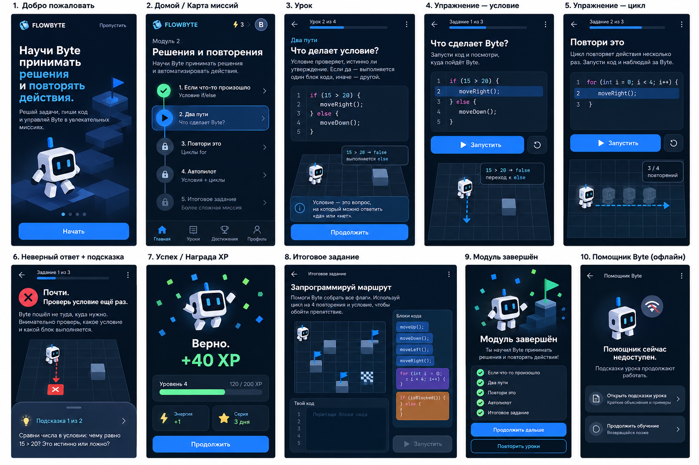
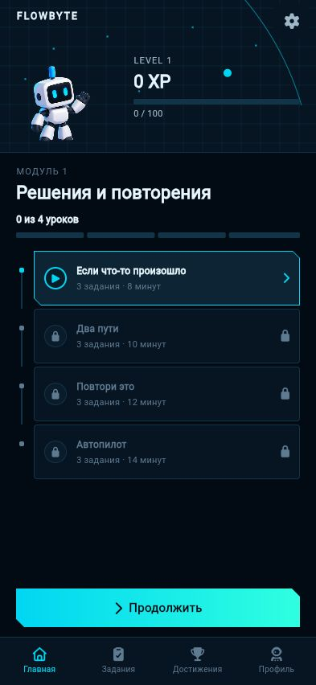
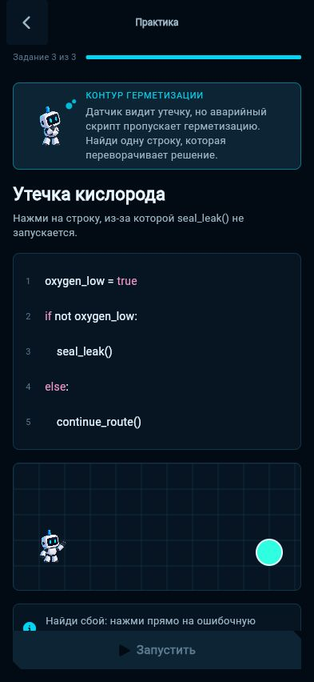
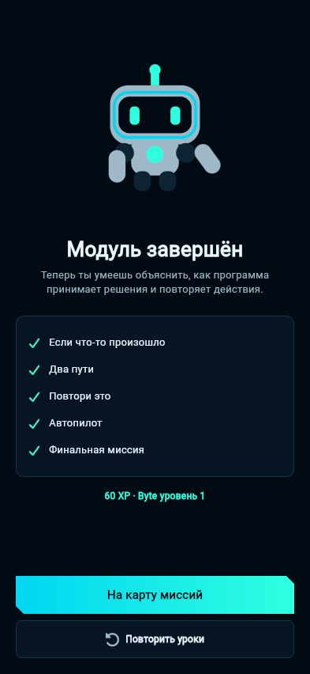
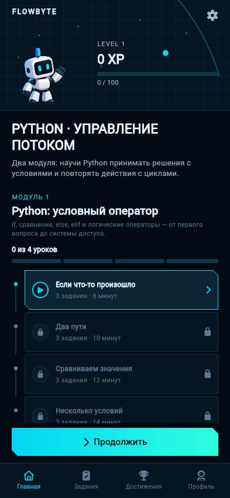
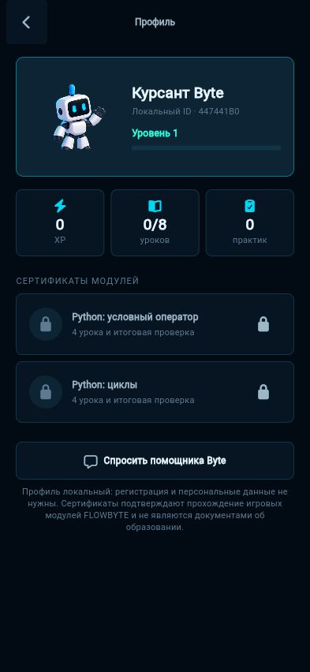
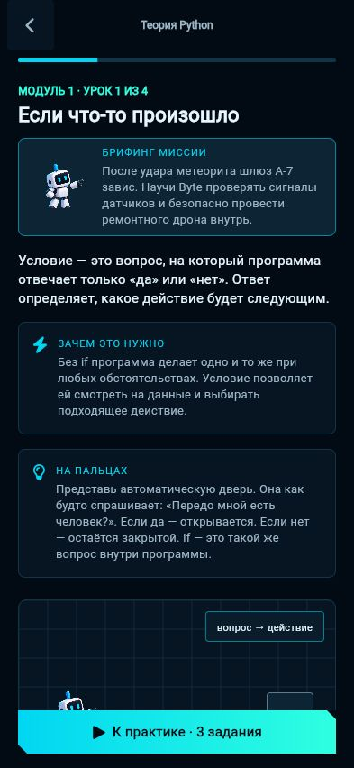
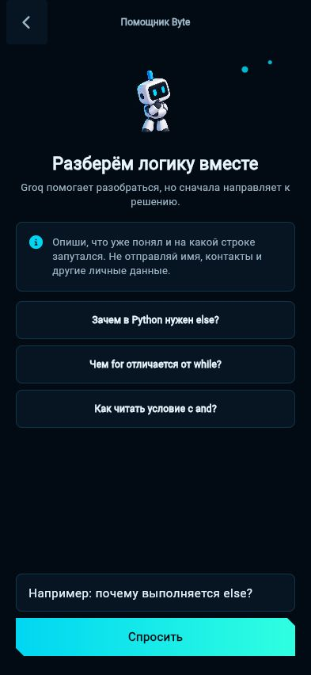

# FLOWBYTE

FLOWBYTE is a local-first Android learning prototype for teenagers. Two modules contain eight plain-language lessons and 32 practical tasks on Python conditions and loops. The signature Live Trace highlights each executed line and moves Byte only when the executed code contains a movement command.

No registration is required. Required lessons, exercises, final mission, XP, Byte levels, replay, and progress persistence work without the backend or AI.



## Product flow

Splash → Welcome → two-step onboarding → Mission Map → two modules × four lessons × four exercises → rewards → final mission → certificates → review/replay.

- **Module 1 — Conditions:** `if`, `else`, comparisons, `elif`, `and`, `or`, `not`.
- **Module 2 — Loops:** `for`, `range`, `while`, infinite-loop safety, `break`, `continue`, and a combined autopilot.

Every lesson answers “what is it?”, “why is it useful?”, “where is it used?” and “what can go wrong?”, adds a rule of thumb, a three-point deep dive, and an interactive self-check before practice. The profile shows local XP, lessons and practices. Each finished module opens a named in-app certificate; it is explicitly presented as a game completion reward, not an official education credential.

Exercise formats: prediction, fix-the-logic, drag/reorder blocks with accessible up/down controls, and the final combined mission. Incorrect answers keep the execution context visible and offer retry plus three progressive hints.

## Design

Selected direction: **Mission Control** — near-black space surfaces, technical grids and route lines, electric cyan actions, mint completion states, clipped corners, compact console hierarchy, and an original code-drawn Byte. See [DESIGN.md](docs/DESIGN.md), the approved [screen-flow reference](design/reference/mission-control-flow.png), and [implementation screenshots](docs/screenshots/).

## Implementation screenshots

| Mission map | Live Trace exercise | Completion |
| --- | --- | --- |
|  |  |  |

| Two-module route | Local profile | Expanded theory | AI tutor |
| --- | --- | --- | --- |
|  |  |  |  |

The complete capture set includes onboarding, lesson, wrong-answer feedback, final mission, reward, and the optional assistant in `docs/screenshots/`.

## Stack

- Flutter 3.41 / Dart 3.11
- Riverpod, go_router, SharedPreferences, Dio, Font Awesome
- FastAPI, Pydantic, async SQLAlchemy
- PostgreSQL 17
- Docker Compose
- Flutter test + pytest

## Run Flutter

```powershell
cd mobile
flutter pub get
flutter run
```

The assistant API address is never committed to the repository. Pass your deployment URL at build time:

```powershell
flutter run --dart-define=FLOWBYTE_API_URL=https://api.example.com/api/v1
```

For the current physical-device build on the same Wi-Fi as this workstation:

```powershell
flutter build apk --release --dart-define=FLOWBYTE_API_URL=https://api.example.com/api/v1
```

The course, answer checking, Live Trace, progress, and progressive hints remain fully local; this URL is used only by the optional helper API.

## Run backend and PostgreSQL

Copy `.env.example` to the ignored root `.env`, set `POSTGRES_PASSWORD` and
paste your private `GIGACHAT_AUTH_KEY` (the Authorization Key from GigaChat
Studio, without `Basic `). GigaChat is now the **only** AI provider; OAuth and
chat-completion requests happen entirely on the FastAPI backend. No credential
is stored in Flutter or the APK.

```powershell
Copy-Item .env.example .env
# Open .env and set POSTGRES_PASSWORD and GIGACHAT_AUTH_KEY

docker compose up -d --build
Invoke-RestMethod http://localhost:2345/api/v1/health
```

The default model is `GigaChat-2-Pro`. Tokens are cached and
refreshed automatically. Errors cause the assistant to display its existing
offline message without interrupting lessons, answer checking or local hints.
If TLS validation fails, follow [GigaChat setup instructions](docs/AI_USAGE.md)
to install trusted certificates or configure `GIGACHAT_CA_BUNDLE`.

Run FastAPI outside Docker:

```powershell
cd backend
py -3 -m venv .venv
.\.venv\Scripts\python -m pip install -r requirements.txt
.\.venv\Scripts\python -m uvicorn app.main:app --port 2345 --reload
```

## Tests

```powershell
cd mobile
flutter analyze
flutter test
flutter build web --release

cd ..\backend
.\.venv\Scripts\python -m pytest
```

The Flutter suite covers all 32 exercises, two-module parsing, scoring, reorder logic, unlocks, XP/levels, progressive hints, trace order, profile/certificates, constructive error feedback, rewards, and a full route through all eight lessons and the final completion screen. Backend tests cover health, both module catalogs, attempts, validation, progress round-trip, exact AI context, the GigaChat OAuth/chat flow, token caching, and automatic refresh.

## Offline and AI behavior

`mobile/assets/content/module.json` is the core content source. Progress is written locally first. Network errors never block required learning. The Byte Assistant is optional, server-only, and shows a clear local-hints fallback when unavailable. See [AI_USAGE.md](docs/AI_USAGE.md).

## Project structure

```text
mobile/                   Flutter app and tests
backend/                  FastAPI, SQLAlchemy, pytest, Dockerfile
design/                   context and frozen visual boards
docs/                     design, API, architecture, AI usage, screenshots
docker-compose.yml        PostgreSQL + API
```

## Known limitations

- The AI tutor requires a configured GigaChat authorization key on the backend; no provider key is included in the APK.
- Device-specific haptic feel and high-refresh performance still need final verification on physical Android hardware.
- The included SQL file is the initial schema; production migration lifecycle tooling is outside this prototype scope.
