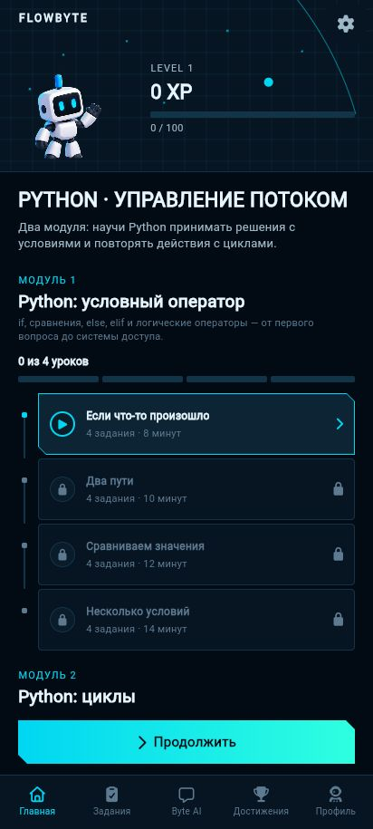
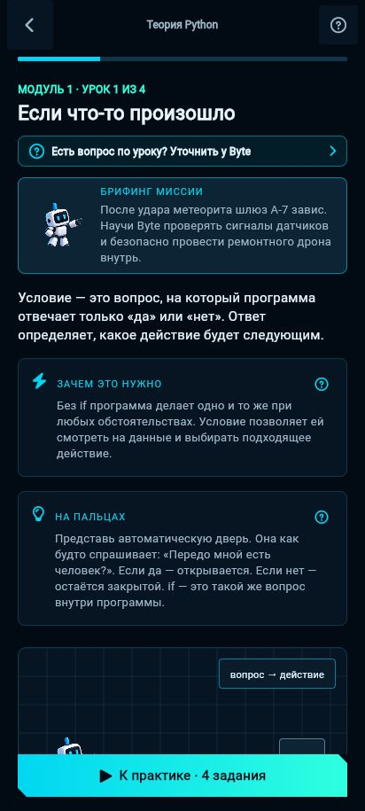
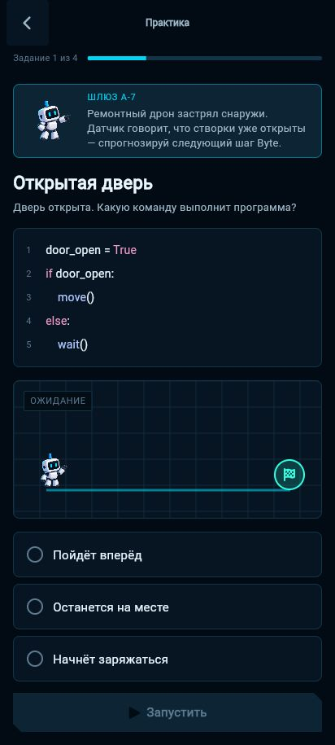
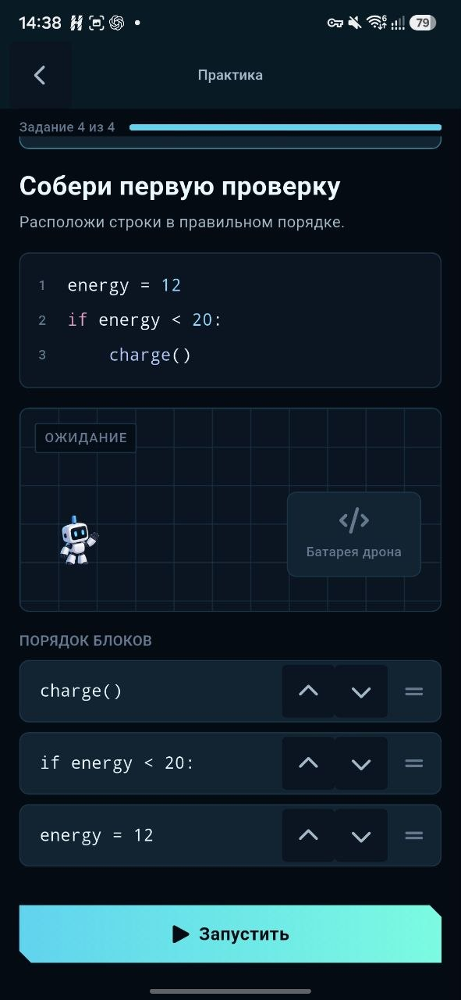
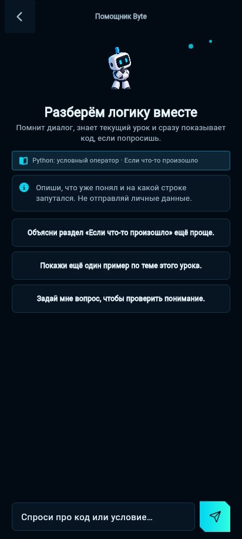
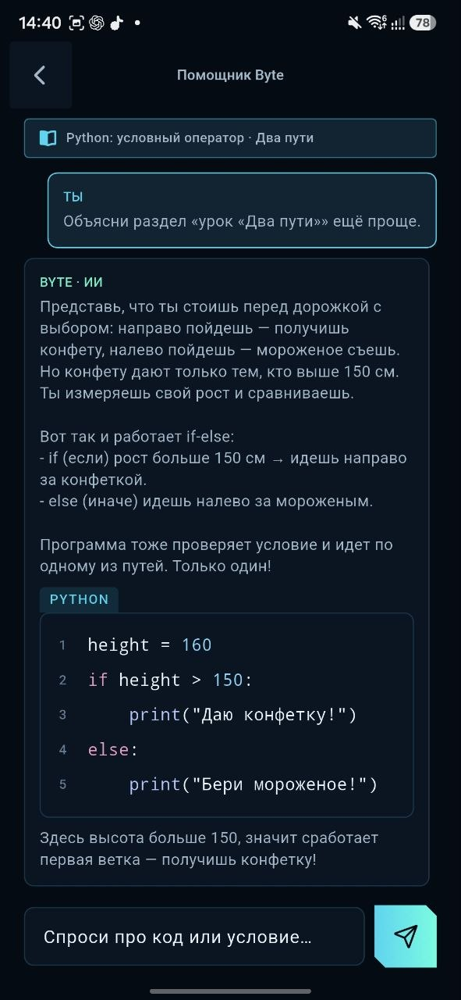
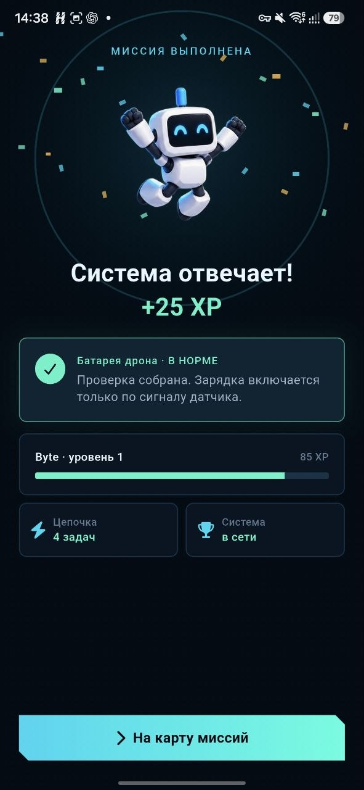
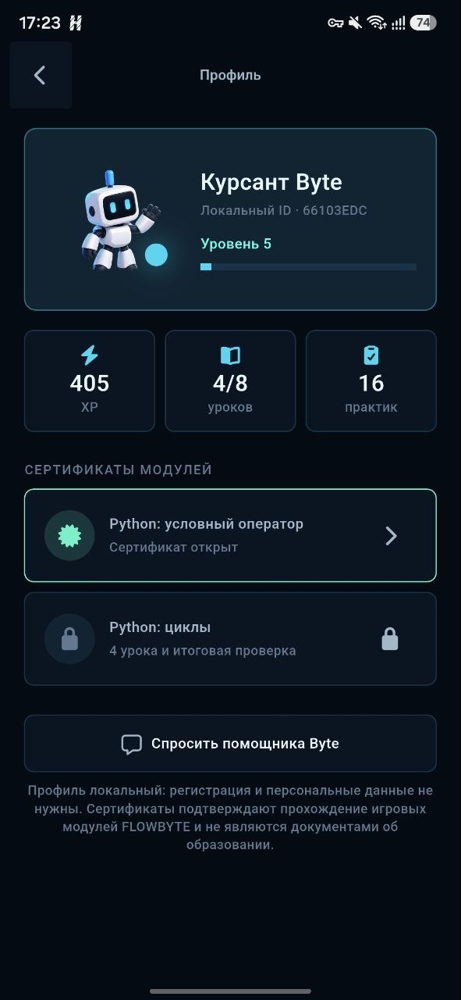
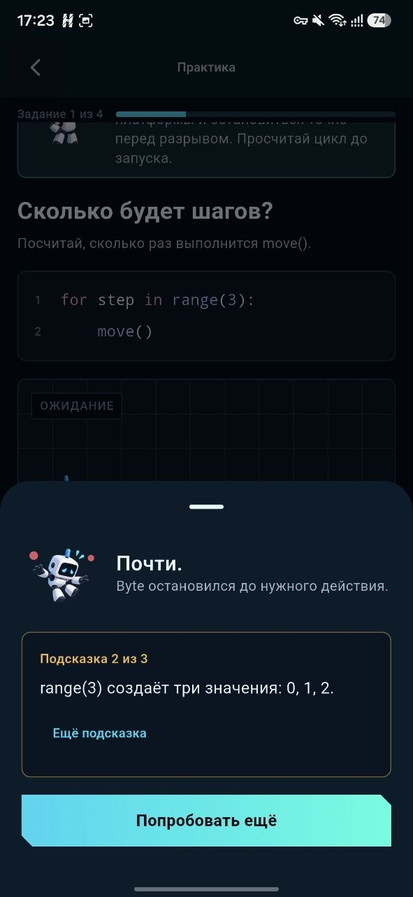

# FLOWBYTE

FLOWBYTE is a local-first Android learning prototype for teenagers. Two modules contain eight plain-language lessons and 32 practical tasks on Python conditions and loops. The signature Live Trace highlights each executed line and moves Byte only when the executed code contains a movement command.

No registration is required. Required lessons, exercises, final mission, XP, Byte levels, replay, and progress persistence work without the backend or AI.

## Product flow

Splash → Welcome → two-step onboarding → Mission Map → two modules × four lessons × four exercises → rewards → final mission → certificates → review/replay.

- **Module 1 — Conditions:** `if`, `else`, comparisons, `elif`, `and`, `or`, `not`.
- **Module 2 — Loops:** `for`, `range`, `while`, infinite-loop safety, `break`, `continue`, and a combined autopilot.

Every lesson answers “what is it?”, “why is it useful?”, “where is it used?” and “what can go wrong?”, adds a rule of thumb, a three-point deep dive, and an interactive self-check before practice. The profile shows local XP, lessons and practices. Each finished module opens a named in-app certificate; it is explicitly presented as a game completion reward, not an official education credential.

Exercise formats: prediction, fix-the-logic, drag/reorder blocks with accessible up/down controls, and the final combined mission. Incorrect answers keep the execution context visible and offer retry plus three progressive hints.

## Design

Selected direction: **Mission Control** — near-black space surfaces, technical grids and route lines, electric cyan actions, mint completion states, clipped corners, compact console hierarchy, and an original code-drawn Byte. See [DESIGN.md](docs/DESIGN.md), the approved [screen-flow reference](design/reference/mission-control-flow.png), and [implementation screenshots](docs/screenshots/).

## Скриншоты работающего приложения

Изображения извлечены из презентации проекта. Каждый экран показан целиком, без обрезки и изменения пропорций.

| Карта миссий | Теория урока | Практика: прогноз результата |
| --- | --- | --- |
|  |  |  |

| Практика: сборка кода | Помощник Byte AI | Диалог с Byte AI |
| --- | --- | --- |
|  |  |  |

| Успешное выполнение и XP | Профиль и сертификаты | Подсказка при ошибке |
| --- | --- | --- |
|  |  |  |

Оригинальные изображения находятся в [docs/screenshots/presentation](docs/screenshots/presentation/).

## Использованные технологии

- Flutter 3.41 / Dart 3.11
- Riverpod, go_router, SharedPreferences, Dio, Font Awesome
- FastAPI, Pydantic, async SQLAlchemy
- PostgreSQL 17
- Docker Compose
- Flutter test + pytest

<a id="run-flutter"></a>

## Запуск приложения

Установите Flutter и Android SDK. Подключите Android-устройство с включённой отладкой по USB или запустите эмулятор. Команды ниже выполняются в PowerShell из папки проекта.

Если проект ещё не скачан:

```powershell
git clone https://github.com/Vadim-maker-source/flowbyte.git
cd flowbyte
```

Загрузите зависимости и запустите приложение:

```powershell
cd mobile
flutter pub get
flutter run
```

Для обучения сервер не обязателен: теория, задания, проверка ответов, анимация выполнения кода и сохранение прогресса работают локально.

### Подключение помощника Byte AI

Адрес сервера помощника задаётся при запуске или сборке. Замените `https://api.example.com/api/v1` на адрес своего сервера:

```powershell
flutter run --dart-define=FLOWBYTE_API_URL=https://api.example.com/api/v1
```

### Сборка APK для Android

В папке `mobile` выполните:

```powershell
flutter build apk --release --dart-define=FLOWBYTE_API_URL=https://api.example.com/api/v1
```

Готовый APK появится в `mobile/build/app/outputs/flutter-apk/app-release.apk`, если отсчитывать путь от корня проекта. Указанный адрес API нужен только помощнику Byte AI.

## Запуск сервера и PostgreSQL

Установите и запустите Docker с поддержкой Docker Compose. Из корня проекта скопируйте `.env.example` в `.env`. Укажите пароль базы в `POSTGRES_PASSWORD` и свой ключ GigaChat в `GIGACHAT_AUTH_KEY` — это Authorization Key из GigaChat Studio без префикса `Basic `.

GigaChat — единственный подключённый ИИ-провайдер. Авторизация и запросы к модели выполняются на сервере FastAPI. Файл `.env` исключён из Git, ключи не входят в приложение и APK.

```powershell
Copy-Item .env.example .env
# Откройте .env и задайте POSTGRES_PASSWORD и GIGACHAT_AUTH_KEY

docker compose up -d --build
Invoke-RestMethod http://localhost:2345/api/v1/health
```

По умолчанию используется модель `GigaChat-2-Pro`. Сервер сохраняет токен доступа и автоматически обновляет его. Если помощник недоступен, приложение сообщает об этом; уроки, проверка ответов и локальные подсказки продолжают работать.

При ошибке проверки TLS-сертификата установите доверенные сертификаты или настройте `GIGACHAT_CA_BUNDLE` по [инструкции подключения GigaChat](docs/AI_USAGE.md).

### Запуск FastAPI без Docker

Команды выполняются из корня проекта. Предварительно настройте подключение к базе и ключ GigaChat в `backend/.env`, используя `backend/.env.example` как образец:

```powershell
cd backend
py -3 -m venv .venv
.\.venv\Scripts\python -m pip install -r requirements.txt
.\.venv\Scripts\python -m uvicorn app.main:app --port 2345 --reload
```

## Проверка приложения и сервера

Из корня проекта выполните проверки Flutter, затем тесты сервера. Для тестов сервера должно быть создано виртуальное окружение `.venv` и установлены зависимости из `backend/requirements.txt`:

```powershell
cd mobile
flutter analyze
flutter test
flutter build web --release

cd ..\backend
.\.venv\Scripts\python -m pytest
```

Тесты Flutter проверяют все 32 задания, загрузку двух модулей, оценку ответов, порядок блоков, открытие уроков, XP и уровни, подсказки, последовательность выполнения кода, профиль, сертификаты и полный маршрут обучения. Тесты сервера проверяют доступность API, каталог модулей, попытки и прогресс, контекст диалога, авторизацию GigaChat и обновление токена.

## Работа без интернета и поведение ИИ

Учебный материал находится в `mobile/assets/content/module.json`. Прогресс в первую очередь сохраняется на устройстве. Ошибки сети не блокируют обучение. Для Byte AI нужны интернет и настроенный сервер; при его недоступности остаются локальные подсказки. Подробности — в [описании работы ИИ](docs/AI_USAGE.md).

## Структура проекта

```text
mobile/                   Приложение Flutter и тесты
backend/                  Сервер FastAPI, SQLAlchemy, pytest, Dockerfile
design/                   Материалы и макеты дизайна
docs/                     Дизайн, API, архитектура, ИИ и скриншоты
docker-compose.yml        Запуск PostgreSQL и API
```

## Известные ограничения

- Для помощника нужен ключ GigaChat в настройках сервера. В APK ключа нет.
- Виброотклик и плавность на экранах с высокой частотой обновления требуют дополнительной проверки на физических Android-устройствах.
- SQL-файл содержит начальную схему базы. Отдельная система миграций для промышленной эксплуатации в прототип не входит.
